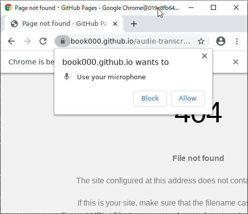
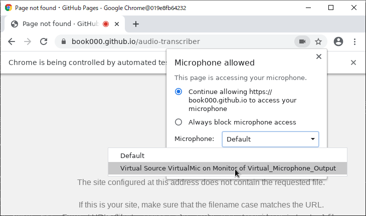

# audio-transcriber-docker

[English README](README.md) (メインの README)

動画・音声ファイルの音声を自動的に書き起こす。Docker コンテナ内で音声を仮想マイクへ再生し、Puppeteer で操作する Chrome の Web Speech API (`webkitSpeechRecognition`、言語は `ja`) で認識する。

## 警告・免責事項

**このプロジェクトを使用したことによって引き起こされた問題に関して開発者は一切の責任を負いません。**

確実な書き起こしが必要なら、代わりに [Google Cloud Speech-to-Text](https://cloud.google.com/speech-to-text) を使ってください。  
サポートは提供しません。

## インストール

### 1. Git Clone

`git clone https://github.com/book000/audio-transcriber-docker.git`

### 2. `start-mount.bat`または`start-mount.sh`を実行 (初めての場合)

Windowsなら`start-mount.bat`、Linuxなら`start-mount.sh`を実行する。  
このプログラム達は`user-dir`フォルダと`output`フォルダをマウントする。

メディアファイルのパスと `DISPLAY` を入力する。コンテナ名は既定値のままでよい (質問の内容は[使い方](#1-startbatまたはstartshを実行)を参照)。

### 3. マイクの使用許可

Chrome にマイクの使用許可と入力デバイスの設定が必要。初回に行い、音声が正常に認識されない場合は再度行う。

#### 3-1. `Allow`を押して許可

#### 3-2. ビデオマークを押し、`Microphone`欄を`Virtual Source Virtual Mic on Monitor of Virtual_Microphone_Output`に変更

### 4. 閉じる

`Ctrl+C`をターミナルで押し、処理を中断する。必要であれば`docker stop audio-transcriber`, `docker rm audio-transcriber`を実行。

## 使い方

インストール後の通常の使い方。

### 1. `start.bat`または`start.sh`を実行

Windowsなら`start.bat`、Linuxなら`start.sh`を実行する。  
このプログラム達は`output`フォルダをマウントする。

出てくる質問は以下。

- `Movie or Audio File Path`
  - 書き起こす動画・音声ファイル。`mp4`、`m4v`、`webm` など `ffmpeg` で変換できるものならなんでもよい。スクリプトが `ffmpeg` で `audio.wav` に変換するため、ホストに `ffmpeg` が必要。
- `DockerName`
  - Docker のコンテナ名。同名の既存コンテナは確認なしで停止・削除されるので注意。
  - 既定値は `audio-transcriber`。
- `DISPLAY`
  - ホストの X11 ディスプレイ (`192.168.0.100:0` など)。コンテナには独自のディスプレイがなく、Chrome はウィンドウ付きで動作する。
  - Windows 用ランチャー (`start.bat` / `start-mount.bat`) では、空欄のまま Enter を押すと `localhost:0` が使われる。

事前に `TeraTerm` や `MobaXterm` などでホスト側に X11 サーバーを用意しておくこと。

### 2. 処理

コンテナ内で Chrome が起動し、音声が仮想マイクへ再生され、認識結果が端末に表示される。

### 3. `output/{DateTime}.txt`を見る

確定した認識結果が `[HH:MM:SS] テキスト` の形式で `output/{DateTime}.txt` に追記される。`{DateTime}` は開始時刻 (ISO 8601 形式。最初の `:` のみ `-` に置換)。

## ライセンス

このプロジェクトのライセンスは [MIT License](LICENSE) です。
