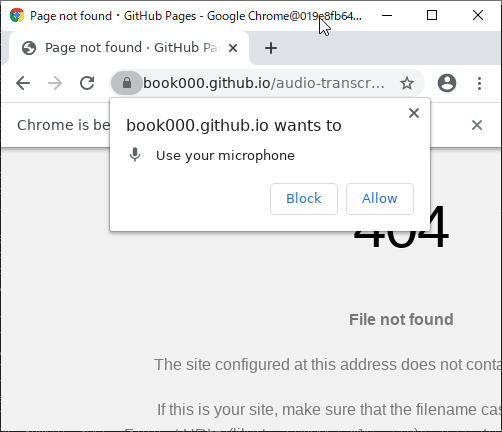
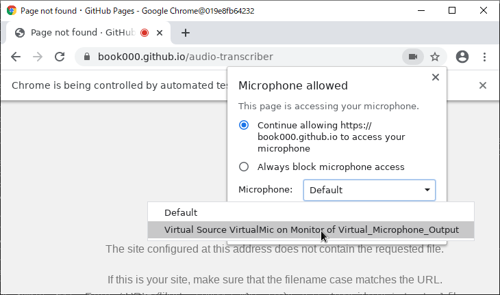

# audio-transcriber-docker

[日本語版 README](README-ja.md) (Japanese translation)

Automatically transcribes the speech in video and audio files. A Docker container plays the audio into a virtual microphone and Chrome's Web Speech API (`webkitSpeechRecognition`, language `ja`) recognizes it, driven by Puppeteer.

## Warning / Disclaimer

**The author is not responsible for any problems caused by the user using this project.**

If you need reliable transcription, use [Google Cloud Speech-to-Text](https://cloud.google.com/speech-to-text) instead.  
No support is provided.

## Installation

### 1. Git Clone

`git clone https://github.com/book000/audio-transcriber-docker.git`

### 2. Run `start-mount.bat` or `start-mount.sh` (First)

Run `start-mount.bat` on Windows, `start-mount.sh` on Linux.  
These programs mount the `user-dir` folder and `output` folder.

Enter a media file path and your `DISPLAY`; the container name can be left at its default (see [Usage](#1-run-startbat-or-startsh) for the questions).

### 3. Permit using microphone

Chrome needs the microphone permission and the right input device. Do this on the first run, and again if the audio is not recognized correctly.

#### 3-1. Press `Allow` to allow

#### 3-2. Press the video symbol and change the `Microphone` field to `Virtual Source Virtual Mic on Monitor of Virtual_Microphone_Output`

### 4. Close the window

Press `Ctrl+C` in the terminal to abort. If necessary, run `docker stop audio-transcriber` and `docker rm audio-transcriber`.

## Usage

For normal use after the installation steps:

### 1. Run `start.bat` or `start.sh`

Run `start.bat` on Windows, `start.sh` on Linux.  
These programs mount the `output` folder.

The questions that come up are below.

- `Movie or Audio File Path`
  - The video or audio file to transcribe. `mp4`, `m4v`, `webm` and anything else `ffmpeg` can convert. The script converts it to `audio.wav` with `ffmpeg`, so `ffmpeg` must be installed on the host.
- `DockerName`
  - Specify the name of the container in Docker. Note that an existing container with this name is stopped and removed without confirmation.
  - Defaults to `audio-transcriber`.
- `DISPLAY`
  - The host's X11 display (e.g., `192.168.0.100:0`). The container has no display of its own, and Chrome runs with a window.

Set up an X11 server on the host first, for example with `TeraTerm` or `MobaXterm`.

### 2. Processing

Chrome starts inside the container, the audio is played into the virtual microphone, and the recognized text is printed to the terminal.

### 3. View the `output/{DateTime}.txt`

Each final result is appended to `output/{DateTime}.txt` as `[HH:MM:SS] text`, where `{DateTime}` is the start time in ISO 8601 format with only the first `:` replaced by `-`.

## License

The license for this project is [MIT License](LICENSE).
